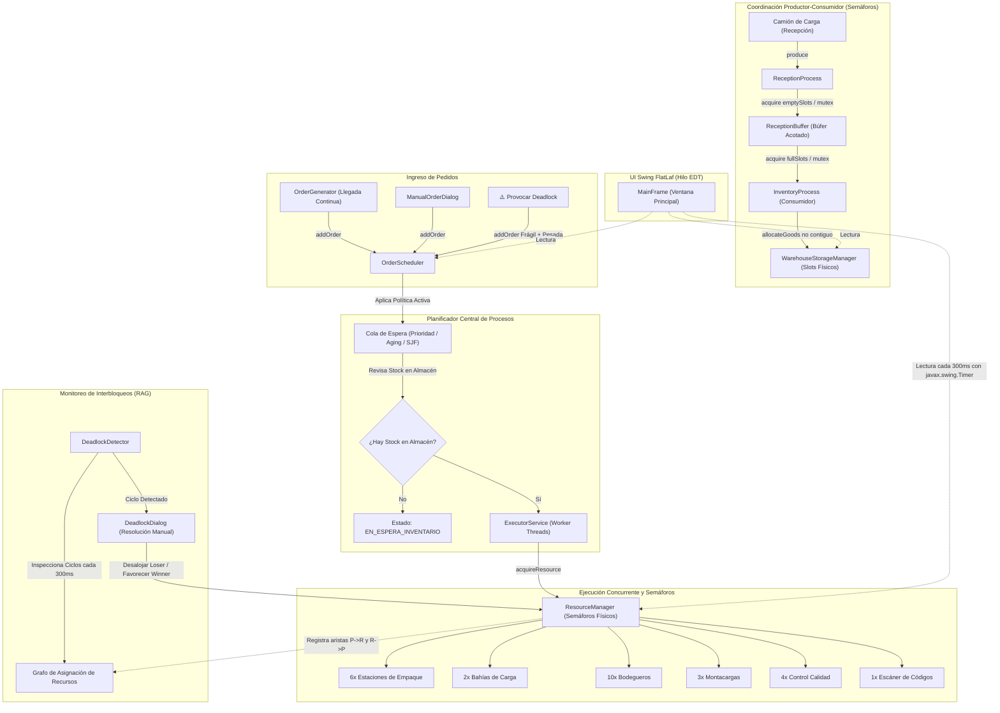

# DOCUMENTO DE ARQUITECTURA TÉCNICA, FLUJO DE EJECUCIÓN Y FUNDAMENTOS DE SISTEMAS OPERATIVOS 2
## Proyecto Final: Centro de Distribución REDXela
**Universidad de San Carlos de Guatemala (USAC) — CUNOC**  
**División de Ciencias de la Ingeniería — Carrera de Ciencias y Sistemas**  
**Curso:** Sistemas Operativos 2 | **Catedrático:** Ing. Otto Soto  

---

## 1. Introducción y Mapeo Conceptual

El propósito del proyecto **REDXela** es simular un centro de distribución multifuncional y paralelo, aplicando de forma estricta y demostrable los conceptos teóricos fundamentales de la materia de **Sistemas Operativos 2**:

| Concepto Teórico de Sistemas Operativos | Implementación Concreta en el Código de REDXela |
| :--- | :--- |
| **Procesos / Hilos de Ejecución Concurrente** | Cada pedido ([`Order.java`](file:///D:/Proyectos/REDXela/src/main/java/com/redxela/model/Order.java)) es ejecutado como una tarea en un hilo independiente gestionado por un grupo de trabajadores (`CachedThreadPool`) en [`OrderScheduler.java`](file:///D:/Proyectos/REDXela/src/main/java/com/redxela/scheduler/OrderScheduler.java). |
| **Exclusión Mutua y Semáforos Contadores** | Las estaciones físicas limitadas se administran mediante semáforos justos (`Semaphore(n, true)`) en [`ResourceManager.java`](file:///D:/Proyectos/REDXela/src/main/java/com/redxela/concurrency/ResourceManager.java). |
| **Comunicación Inter-Procesos / Búfer Acotado** | Recepción e Inventario se comunican mediante el problema clásico del Productor-Consumidor con 3 semáforos (`emptySlots`, `fullSlots`, `mutex`) en [`ReceptionBuffer.java`](file:///D:/Proyectos/REDXela/src/main/java/com/redxela/concurrency/ReceptionBuffer.java). |
| **Administración de Memoria No Contigua (Paginación)** | El almacenamiento en pasillos, racks y niveles divide los lotes en slots físicos dispersos usando una tabla de asignación en [`WarehouseStorageManager.java`](file:///D:/Proyectos/REDXela/src/main/java/com/redxela/storage/WarehouseStorageManager.java). |
| **Planificación de Procesos y Prevención de Inanición** | Algoritmos de planificación intercambiables en tiempo real: Prioridad Estricta ([`StrictPriorityPolicy.java`](file:///D:/Proyectos/REDXela/src/main/java/com/redxela/scheduler/StrictPriorityPolicy.java)), Envejecimiento o Aging ([`AgingPriorityPolicy.java`](file:///D:/Proyectos/REDXela/src/main/java/com/redxela/scheduler/AgingPriorityPolicy.java)) y Trabajo Más Corto Primero ([`SjfPolicy.java`](file:///D:/Proyectos/REDXela/src/main/java/com/redxela/scheduler/SjfPolicy.java)). |
| **Interbloqueo (Deadlock), Grafo RAG y Desalojo** | Detección de ciclos en el Grafo de Asignación de Recursos (RAG) y resolución manual mediante desalojo forzoso (*Preemption*) en [`DeadlockDetector.java`](file:///D:/Proyectos/REDXela/src/main/java/com/redxela/concurrency/DeadlockDetector.java) y [`DeadlockDialog.java`](file:///D:/Proyectos/REDXela/src/main/java/com/redxela/ui/DeadlockDialog.java). |

---

## 2. Diagrama de Arquitectura General del Sistema

El siguiente diagrama en lenguaje Mermaid ilustra cómo interactúan los componentes en memoria y el flujo de los hilos:



---

## 3. Módulo de Comunicación Productor-Consumidor (Recepción $\rightarrow$ Inventario)

### Fundamento Teórico de SO:
En sistemas concurrentes, dos subsistemas desacoplados que operan a velocidades dispares no deben compartir ni modificar directamente sus estructuras internas. Se implementa un **Búfer Acotado de Capacidad Limitada (Bounded Buffer)** utilizando los semáforos clásicos formulados por Edsger Dijkstra.

### Clases Involucradas:
* [`GoodsArrival.java`](file:///D:/Proyectos/REDXela/src/main/java/com/redxela/model/GoodsArrival.java): Objeto inmutable (*record*) que transporta los datos del lote (`batchId`, `product`, `units`, `timestamp`).
* [`ReceptionProcess.java`](file:///D:/Proyectos/REDXela/src/main/java/com/redxela/concurrency/ReceptionProcess.java): El **Productor**.
* [`ReceptionBuffer.java`](file:///D:/Proyectos/REDXela/src/main/java/com/redxela/concurrency/ReceptionBuffer.java): El **Búfer Sincronizado**.
* [`InventoryProcess.java`](file:///D:/Proyectos/REDXela/src/main/java/com/redxela/concurrency/InventoryProcess.java): El **Consumidor** que corre en su propio hilo daemon `Thread-Inventory-Consumer`.

### Mecanismo de Sincronización en [`ReceptionBuffer.java`](file:///D:/Proyectos/REDXela/src/main/java/com/redxela/concurrency/ReceptionBuffer.java):
El búfer mantiene tres variables de control de concurrencia:
```java
private final Semaphore emptySlots; // Permisos para escribir (inicia en bufferCapacity, ej. 15)
private final Semaphore fullSlots;  // Permisos para leer (inicia en 0)
private final ReentrantLock mutex;  // Exclusión mutua para la estructura Queue interna
```

#### Protocolo del Productor (`produce`):
```java
public void produce(GoodsArrival arrival) throws InterruptedException {
    emptySlots.acquire(); // 1. Decrementa espacios vacíos. Si es 0, el productor se DUERME.
    mutex.lock();         // 2. Entra a la región crítica (exclusión mutua).
    try {
        queue.add(arrival);
    } finally {
        mutex.unlock();   // 3. Sale de la región crítica.
    }
    fullSlots.release();  // 4. Incrementa elementos listos y DESPIERTA al consumidor dormido.
}
```

#### Protocolo del Consumidor (`consume`):
```java
public GoodsArrival consume() throws InterruptedException {
    fullSlots.acquire();  // 1. Decrementa elementos disponibles. Si es 0, el consumidor se DUERME.
    GoodsArrival item;
    mutex.lock();         // 2. Entra a la región crítica.
    try {
        item = queue.poll();
    } finally {
        mutex.unlock();   // 3. Sale de la región crítica.
    }
    emptySlots.release(); // 4. Incrementa espacios vacíos y DESPIERTA al productor si estaba lleno.
    return item;
}
```
**Justificación para la defensa:** Este diseño garantiza que, aunque Recepción reciba 1,000 camiones por segundo, jamás habrá desbordamiento de memoria (*buffer overflow*) ni condiciones de carrera (*race conditions*).

---

## 4. Módulo de Almacenamiento: Paginación No Contigua de Almacén

### Fundamento Teórico de SO:
En la gestión de memoria física, la **Paginación** elimina la necesidad de asignar memoria contigua. La memoria física se divide en **Marcos de Página (Frames)** de tamaño fijo. Cuando un proceso requiere $N$ unidades de memoria, el sistema operativo le asigna $N$ marcos disponibles en cualquier ubicación física dispersa, manteniendo un registro en una **Tabla de Páginas**.

### Clases Involucradas:
* [`WarehouseSlot.java`](file:///D:/Proyectos/REDXela/src/main/java/com/redxela/model/WarehouseSlot.java): Modela la unidad mínima física (Slot = Marco de Página). Tiene coordenadas tridimensionales: Pasillo (`aisle`), Estante (`rack`) y Nivel de altura (`level`), con capacidad fija.
* [`WarehouseStorageManager.java`](file:///D:/Proyectos/REDXela/src/main/java/com/redxela/storage/WarehouseStorageManager.java): Modela el Gestor del Almacén (MMU / Administrador de Memoria).

### El Algoritmo de Asignación No Contigua:
Cuando [`InventoryProcess.java`](file:///D:/Proyectos/REDXela/src/main/java/com/redxela/concurrency/InventoryProcess.java) consume un lote de mercadería de $U$ unidades:
1. Invoca `storageManager.allocateGoods(batchId, product, unitsToStore)`.
2. El gestor bloquea el almacén con `storageLock` (thread-safe).
3. Itera la lista de slots buscando cualquier slot donde `slot.isAvailable()` sea verdadero.
4. Deposita tantas unidades como quepan en ese slot (hasta su capacidad máxima, ej. 15 unidades por slot).
5. Las unidades restantes se depositan en el siguiente slot libre disponible, sin importar si está en otro pasillo o nivel.
6. Registra la asignación en la **Tabla de Páginas del Almacén**:
   $$\text{batchAllocationTable}: \quad \text{Lote-ID} \longrightarrow [\text{Slot}_{P01-R02-N01}, \text{Slot}_{P04-R01-N03}, \dots]$$
7. Actualiza la existencia total global del producto en `stockMap`.

### Algoritmo de Consumo (Despacho de Pedidos):
Cuando un pedido se procesa, llama a `consumeStock(product, unitsNeeded)`:
* Recorre los slots que contienen ese producto específico.
* Ejecuta `slot.release(units)`.
* Si un slot queda con 0 unidades almacenadas, se restablece a `null` y pasa inmediatamente al estado **LIBRE**, quedando disponible para nuevos lotes entrantes.

---

## 5. Módulo de Recursos Compartidos y Exclusión Mutua

### Fundamento Teórico de SO:
Un sistema operativo maneja **Recursos Reutilizables de Múltiples Instancias**. Para modelar instancias idénticas de un recurso (como CPUs, impresoras o, en este caso, bahías de carga y montacargas), la primitiva por excelencia es el **Semáforo Contador**.

### Clases Involucradas:
* [`ResourceType.java`](file:///D:/Proyectos/REDXela/src/main/java/com/redxela/model/ResourceType.java): Enum que define el inventario físico total del centro:
  * 6 Estaciones de empaque (`PACKING_STATION`)
  * 2 Bahías de carga para camiones (`LOADING_DOCK`)
  * 10 Encargados de bodega (`WAREHOUSE_WORKER`)
  * 3 Montacargas (`FORKLIFT`)
  * 4 Estaciones de control de calidad (`QUALITY_STATION`)
  * 1 Escáner central de códigos de barra (`BARCODE_SCANNER`, recurso único / mutex)
* [`ResourceManager.java`](file:///D:/Proyectos/REDXela/src/main/java/com/redxela/concurrency/ResourceManager.java): Motor de asignación de recursos.

### Características Clave de Implementación:
1. **Semáforos Justos (FIFO Fairness):**
   ```java
   semaphores.put(type, new Semaphore(type.getTotalCapacity(), true));
   ```
   El parámetro booleano `true` en el constructor de `Semaphore` garantiza que la cola interna de espera respete el orden FIFO en el que los hilos solicitaron el recurso. Esto previene que un hilo quede relegado perpetuamente (*starvation a nivel de semáforo*).
2. **Seguimiento del Grafo de Asignación de Recursos (RAG):**
   Cada vez que un pedido solicita un recurso, se registra en estructuras concurrentes:
   * `orderWaitingFor`: Mapea $\text{Pedido} \rightarrow \text{Recurso}$ (Arista de Solicitud).
   * `resourceHolders`: Mapea $\text{Recurso} \rightarrow \{\text{Pedidos}\}$ (Aristas de Asignación).

---

## 6. Módulo de Planificación de Pedidos (Scheduling)

### Fundamento Teórico de SO:
El planificador a corto plazo del SO decide qué proceso de la cola de listos (`READY`) obtiene el procesador. En REDXela, el planificador decide qué pedido en espera pasa a consumir los recursos físicos.

### Clases Involucradas:
* [`OrderScheduler.java`](file:///D:/Proyectos/REDXela/src/main/java/com/redxela/scheduler/OrderScheduler.java): Motor planificador concurrente.
* [`ServiceLevel.java`](file:///D:/Proyectos/REDXela/src/main/java/com/redxela/model/ServiceLevel.java): Niveles SLA (1: Exprés, 2: Prioritario, 3: Estándar, 4: Programado, 5: Económico).
* [`StrictPriorityPolicy.java`](file:///D:/Proyectos/REDXela/src/main/java/com/redxela/scheduler/StrictPriorityPolicy.java)
* [`AgingPriorityPolicy.java`](file:///D:/Proyectos/REDXela/src/main/java/com/redxela/scheduler/AgingPriorityPolicy.java)
* [`SjfPolicy.java`](file:///D:/Proyectos/REDXela/src/main/java/com/redxela/scheduler/SjfPolicy.java)

### Análisis Comparativo de las Tres Políticas:

#### A. Prioridad Estricta por SLA (`StrictPriorityPolicy`)
* **Criterio de orden:** Nivel 1 (Exprés) primero, hasta Nivel 5 (Económico). Desempate por tiempo de llegada (FCFS).
* **Fórmula:**
  $$\text{Comparator} = \text{Order.ServiceLevel.getLevel()}$$
* **Problema teórico:** Sufre de **Inanición (Starvation)**. Si la llegada de pedidos Nivel 1 y Nivel 2 es continua, los pedidos de Nivel 5 pueden quedar esperando indefinidamente sin procesarse nunca.

#### B. Prioridad Dinámica con Envejecimiento (`AgingPriorityPolicy`)
* **Criterio de orden:** Combina la prioridad contratada con un bono que crece proporcionalmente al tiempo que el pedido lleva esperando en la cola.
* **Fórmula matemática implementada en [`Order.java`](file:///D:/Proyectos/REDXela/src/main/java/com/redxela/model/Order.java):**
  $$\text{PrioridadAging} = (6 - \text{NivelSLA}) \times 20 + (\text{SegundosEsperando} \times 1.5)$$
  * *Ejemplo:*
    * Un pedido Exprés (Nivel 1) recién llegado obtiene: $(6 - 1) \times 20 + 0 = 100 \text{ pts}$.
    * Un pedido Económico (Nivel 5) recién llegado obtiene: $(6 - 5) \times 20 + 0 = 20 \text{ pts}$.
    * Si el pedido Económico espera 60 segundos: $20 + (60 \times 1.5) = 110 \text{ pts}$.
    * **Resultado:** ¡Supera los 100 pts del pedido Exprés recién llegado y pasa a ejecución! Esto elimina la inanición por completo.

#### C. Trabajo Más Corto Primero (`SjfPolicy`)
* **Criterio de orden:** Atiende primero a los pedidos con menor cantidad total de artículos (`totalUnits`).
* **Justificación de SO:** Basado en el teorema de Shortest-Job-First, minimiza el tiempo promedio de espera global de la cola y maximiza el rendimiento (*throughput*), ya que los pedidos pequeños ocupan las estaciones de empaque y calidad por muy poco tiempo y las liberan rápidamente.

---

## 7. Módulo de Interbloqueos: Deadlock y Grafo RAG

### Fundamento Teórico de SO:
Un interbloqueo (*deadlock*) es una situación donde dos o más procesos están detenidos permanentemente porque cada uno retiene recursos que los otros necesitan para continuar.

Para que exista Deadlock deben cumplirse simultáneamente las **4 Condiciones de Coffman**:
1. **Exclusión Mutua:** Los recursos no son compartibles simultáneamente.
2. **Retención y Espera (*Hold and Wait*):** Un proceso retiene al menos un recurso mientras espera adquirir otros adicionales retenidos por otros procesos.
3. **No Desalojo (*No Preemption*):** Los recursos no pueden ser retirados forzosamente de los procesos; solo se liberan voluntariamente al terminar.
4. **Espera Circular (*Circular Wait*):** Existe una cadena cerrada de procesos $\{P_0, P_1, \dots, P_n\}$ tal que $P_0$ espera un recurso retenido por $P_1$, y $P_n$ espera un recurso retenido por $P_0$.

### La Provocación Deliberada del Deadlock en REDXela:
En [`MerchandiseType.java`](file:///D:/Proyectos/REDXela/src/main/java/com/redxela/model/MerchandiseType.java), diseñamos intencionalmente dos tipos de mercancía con solicitudes de recursos en orden inverso:

```
[Pedido A - Tipo Frágil]                     [Pedido B - Tipo Pesada]
           │                                            │
Adquiere: CONTROL DE CALIDAD                 Adquiere: MONTACARGAS
(Lo retiene en su mano)                      (Lo retiene en su mano)
           │                                            │
           │─────── Ambos compiten al mismo tiempo ─────│
           ▼                                            ▼
Solicita: MONTACARGAS                        Solicita: CONTROL DE CALIDAD
(Queda BLOQUEADO esperando a B)              (Queda BLOQUEADO esperando a A)
```

En [`OrderScheduler.java`](file:///D:/Proyectos/REDXela/src/main/java/com/redxela/scheduler/OrderScheduler.java), el método `executeDeadlockScenario` sincroniza deliberadamente ambos pedidos con una pequeña pausa para forzar que ambos adquieran su primer recurso antes de que cualquiera intente adquirir el segundo.

### El Algoritmo de Detección en [`DeadlockDetector.java`](file:///D:/Proyectos/REDXela/src/main/java/com/redxela/concurrency/DeadlockDetector.java):
El detector corre periódicamente cada 300 ms en un hilo programado (`ScheduledExecutorService`):
1. Obtiene una instantánea segura del Grafo de Asignación de Recursos (`orderWaitingFor` y `resourceHolders`).
2. Para cada pedido $P_A$ que espera un recurso $R_X$:
   * Busca quién o quiénes retienen $R_X$. Sea $P_B$ uno de ellos.
   * Verifica si $P_B$ está a su vez esperando algún recurso $R_Y$.
   * Si $P_A$ retiene $R_Y$, **se ha detectado un ciclo cerrado $P_A \rightarrow R_X \rightarrow P_B \rightarrow R_Y \rightarrow P_A$**.
3. Cambia el estado de ambos pedidos a `OrderStatus.BLOQUEADO_DEADLOCK`.
4. Dispara un evento concurrente a la interfaz gráfica.

### Resolución Manual por Desalojo (*Preemption*):
En [`DeadlockDialog.java`](file:///D:/Proyectos/REDXela/src/main/java/com/redxela/ui/DeadlockDialog.java), se presenta el diagnóstico completo al usuario y dos botones de decisión:
* **Si el usuario elige favorecer al Pedido A:**
  1. El Pedido B se convierte en el proceso desfavorecido (*victim process*).
  2. Se invoca `resourceManager.releaseAllResources(orderB)`. Todos los semáforos retenidos por B son liberados forzosamente con `sem.release()`.
  3. El Pedido B es retirado de ejecución y se reinserta en la cola de espera (`reenqueuePreemptedOrder`).
  4. Al liberarse los recursos, el semáforo despierta automáticamente al Pedido A, quien toma el montacargas disputado y finaliza su flujo con éxito.

---

## 8. Módulo de Interfaz Gráfica y Concurrencia en Swing

### Fundamento Teórico de SO/Java:
En la programación de interfaces en Java Swing, existe una regla estricta: **Swing no es thread-safe y opera bajo un único hilo llamado Event Dispatch Thread (EDT)**. Si un hilo de simulación de empaque ejecuta `Thread.sleep(5000)` dentro del EDT, la ventana completa se congela (*Not Responding*).

### Solución Arquitectónica Implementada:
1. **Desacoplamiento Total de Hilos:**
   * La simulación física y los semáforos corren en hilos de fondo gestionados por `Executors.newCachedThreadPool()`.
   * El hilo de la interfaz nunca invoca `acquire()` ni se duerme.
2. **Refresco Reactivo mediante `javax.swing.Timer`:**
   En [`MainFrame.java`](file:///D:/Proyectos/REDXela/src/main/java/com/redxela/ui/MainFrame.java), un timer de Swing se dispara cada 300 ms dentro del EDT:
   * Consulta las colecciones concurrentes (`ConcurrentHashMap`, `CopyOnWriteArrayList`, variables `volatile`).
   * Actualiza el modelo de las tablas (`processingModel`, `waitingModel`) y las barras de progreso sin bloquear la simulación.
3. **Invocación Segura de Diálogos:**
   Cuando el hilo detector de Deadlocks detecta un ciclo en segundo plano, no abre la ventana directamente; utiliza:
   ```java
   SwingUtilities.invokeLater(() -> {
       DeadlockDialog dlg = new DeadlockDialog(...);
       dlg.setVisible(true);
   });
   ```
   Esto encola la apertura de la ventana de forma segura dentro del EDT.

---

## 9. Guía de Preguntas Clave para la Defensa del Proyecto

Si el Ing. Otto Soto o el auxiliar te hacen estas preguntas durante la calificación, aquí tienes las respuestas directas basadas en tu código:

| Pregunta Típica de Examen | Respuesta Técnica y Dónde Señalar en el Código |
| :--- | :--- |
| **¿Por qué usaron Semáforos en lugar de solo `synchronized`?** | Porque los semáforos contadores (`Semaphore`) permiten manejar múltiples instancias de un mismo recurso físico (como 6 estaciones de empaque o 3 montacargas) y admiten el modo `fair = true` para garantizar orden FIFO. `synchronized` es un monitor binario exclusivo. Señalar: [`ResourceManager.java`](file:///D:/Proyectos/REDXela/src/main/java/com/redxela/concurrency/ResourceManager.java#L25). |
| **¿Cómo garantizan que Recepción no sature la memoria si llegan camiones muy rápido?** | Con el semáforo `emptySlots` del búfer acotado. Si el búfer de 15 lotes se llena, el hilo de Recepción se bloquea en `emptySlots.acquire()` hasta que Inventario libere un espacio. Señalar: [`ReceptionBuffer.java`](file:///D:/Proyectos/REDXela/src/main/java/com/redxela/concurrency/ReceptionBuffer.java#L35). |
| **¿Cómo demostraron el almacenamiento no contiguo?** | Los lotes de productos se fragmentan en unidades que se reparten en una matriz tridimensional de slots físicos (Pasillo, Rack, Nivel) dispersos, guardando la relación en una tabla de asignación análoga a la tabla de páginas de un SO. Señalar: [`WarehouseStorageManager.java`](file:///D:/Proyectos/REDXela/src/main/java/com/redxela/storage/WarehouseStorageManager.java#L40). |
| **¿Por qué ocurre el Deadlock y cómo lo detectan?** | Ocurre por retención y espera circular mutua (*Hold and Wait* + *Circular Wait*) entre la mercancía Frágil y Pesada al pedir Calidad y Montacargas en orden inverso. El detector recorre las aristas de asignación y solicitud del RAG buscando ciclos cerrados. Señalar: [`DeadlockDetector.java`](file:///D:/Proyectos/REDXela/src/main/java/com/redxela/concurrency/DeadlockDetector.java#L65). |
| **¿Cómo resolvieron el Deadlock?** | Mediante desalojo (*preemption*). El usuario selecciona qué pedido continúa; el otro pedido libera todos sus semáforos retenidos con `releaseAllResources` y se reinserta en la cola de espera para reintentarlo después. Señalar: [`DeadlockDetector.java`](file:///D:/Proyectos/REDXela/src/main/java/com/redxela/concurrency/DeadlockDetector.java#L115). |
| **¿Cómo evitaron que los pedidos económicos sufran de inanición?** | Con la política de envejecimiento (*Aging*), sumando un bono dinámico de 1.5 puntos por cada segundo de espera acumulado en la cola. Señalar: [`Order.java`](file:///D:/Proyectos/REDXela/src/main/java/com/redxela/model/Order.java#L48). |
