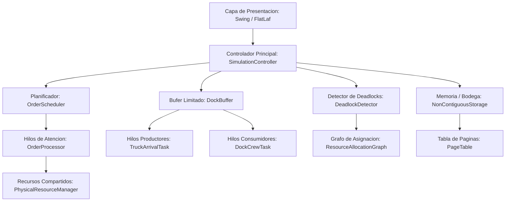

# MANUAL TÉCNICO - SISTEMA REDXELA
**Simulador de Centro de Distribución y Planificación de Procesos Logísticos**  
**Curso:** Sistemas Operativos 2 — USAC CUNOC  
**Versión:** 1.0.0  
**Fecha:** Octubre 2026  

---

## 1. INTRODUCCIÓN Y DESCRIPCIÓN DEL SISTEMA

REDXela es una solución de software orientada a simular, modelar y supervisar de forma visual los procesos concurrentes de un Centro de Distribución (Warehouse & Fulfillment Center). La plataforma implementa de forma práctica los conceptos fundamentales de la teoría de Sistemas Operativos modernos:

- **Procesos y Bloques de Control de Procesos (PCB):** Modelados como órdenes de pedido (`Order`).
- **Planificación de CPU (CPU Scheduling):** Políticas FCFS, SJF, Prioridad con Envejecimiento (Aging) y Round Robin.
- **Sincronización y Exclusión Mutua:** Control de acceso a recursos físicos limitados mediante semáforos y mutex.
- **Problema del Búfer Limitado (Productor-Consumidor):** Descarga de camiones hacia muelles de recepción con capacidad acotada.
- **Gestión de Memoria y Paginación:** Almacenamiento no contiguo de mercancías en ranuras físicas de bodega usando tablas de páginas.
- **Detección y Recuperación de Interbloqueos (Deadlocks):** Modelado con Grafos de Asignación de Recursos (RAG), detección de ciclos de Coffman y resolución por desapropiación (preemption).

---

## 2. REQUISITOS DEL SISTEMA Y TECNOLOGÍAS

### 2.1 Requisitos Mínimos de Ejecución
- **Sistema Operativo:** Windows 10/11, Linux (kernel 5.x+) o macOS 12+.
- **Java Runtime Environment (JRE):** OpenJDK 21 (LTS) de 64 bits o superior.
- **Memoria RAM:** Mínimo 2 GB libres (recomendado 4 GB).
- **Resolución de Pantalla:** 1280 x 720 píxeles o superior.

### 2.2 Tecnologías y Librerías Utilizadas
| Tecnología | Versión | Propósito |
| :--- | :--- | :--- |
| **Java** | 21 (LTS) | Lenguaje base, soporte de concurrencia estructurada y Threading moderno. |
| **Apache Maven** | 3.9+ | Gestor de ciclo de vida del proyecto, dependencias y compilación. |
| **FlatLaf (macOS Dark)** | 3.5.4 | Look and Feel moderno, responsivo y de alto contraste para interfaz Swing. |
| **Lombok** | 1.18.34 | Reducción de código repetitivo (Boilerplate de getters, setters y constructores). |

---

## 3. ARQUITECTURA DEL SOFTWARE

El proyecto implementa una arquitectura modular desacoplada basada en capas funcionales con separación estricta entre la lógica de negocio/concurrencia y la interfaz gráfica de usuario (GUI):



### 3.1 Estructura de Paquetes
- `com.redxela.model`: Clases de datos y entidades del dominio (`Order`, `Truck`, `Item`, `PhysicalResource`).
- `com.redxela.concurrency`: Implementaciones de sincronización, semáforos, productores y consumidores.
- `com.redxela.scheduler`: Políticas de planificación (FCFS, SJF, Aging, Round Robin).
- `com.redxela.storage`: Modelado de almacenamiento no contiguo, marcos físicos y tablas de páginas.
- `com.redxela.deadlock`: Grafo de Asignación de Recursos (RAG), detección de ciclos y desapropiación.
- `com.redxela.service`: Orquestadores de simulación y generadores aleatorios de carga.
- `com.redxela.ui`: Componentes gráficos Swing (Dashboard de Operaciones, Vista de Bodega, Tablas de SLA).

---

## 4. SINCRONIZACIÓN Y CONCURRENCIA

En REDXela, múltiples pedidos compiten de forma simultánea por un conjunto limitado de recursos físicos operacionales. El acceso seguro y ordenado se garantiza mediante primitivas de sincronización del paquete `java.util.concurrent`.

### 4.1 Recursos Físicos del Centro de Distribución
Cada tipo de recurso físico se modela como un conjunto acotado de instancias protegidas por un semáforo contador (`Semaphore`):

| Recurso Físico | Instancias | Semáforo / Primitiva | Propósito en la Operación |
| :--- | :---: | :--- | :--- |
| **Montacargas (Forklifts)** | 3 | `Semaphore(3, true)` | Movimiento vertical y pesado de pallets hacia las bahías. |
| **Estaciones de Calidad** | 2 | `Semaphore(2, true)` | Inspección física, escaneo y verificación de integridad. |
| **Zonas de Empaque (Packing)** | 4 | `Semaphore(4, true)` | Embalaje, colocación de etiquetas y precintado. |
| **Puertas de Carga (Loading Docks)** | 2 | `Semaphore(2, true)` | Despacho final hacia los camiones de entrega. |

> **Nota:** Todos los semáforos se inicializan en modo justo (`fair = true`) para garantizar una política FIFO estricta en las solicitudes y evitar inanición a nivel de hilos de sistema operativo.

### 4.2 Protocolo de Adquisición y Liberación
La adquisición y liberación de recursos se encapsula en la clase `PhysicalResourceManager`. Los métodos utilizan bloques `try-finally` para evitar fugas de permisos ante excepciones:

```java
public boolean acquireResource(ResourceType type, long timeoutMs) throws InterruptedException {
    Semaphore semaphore = semaphores.get(type);
    boolean acquired = semaphore.tryAcquire(timeoutMs, TimeUnit.MILLISECONDS);
    if (acquired) {
        availableUnits.get(type).decrementAndGet();
    }
    return acquired;
}

public void releaseResource(ResourceType type) {
    availableUnits.get(type).incrementAndGet();
    semaphores.get(type).release();
}
```

---

## 5. PROBLEMA DEL PRODUCTOR - CONSUMIDOR (BÚFER LIMITADO)

El flujo de recepción de mercancía implementa formalmente el clásico problema del **Búfer Acotado (Bounded Buffer)**:

```
[Camión Productor] ---> (Intenta Insertar) ---> [ BÚFER DEL MUELLE (Capacidad = 10) ] ---> (Extrae Ítems) ---> [Cuadrilla Consumidora]
                                                | Semáforo emptySlots = 10           |
                                                | Semáforo fullItems  = 0            |
                                                | ReentrantLock (Mutex)              |
```

### 5.1 Mecanismo de Sincronización
La clase `DockBuffer` gestiona un búfer circular de capacidad fija ($N = 10$ pallets/cajas):

1. **Semáforo `emptySlots`:** Inicializado en 10. Representa los espacios libres disponibles en el muelle.
2. **Semáforo `fullItems`:** Inicializado en 0. Representa los artículos disponibles para ser procesados.
3. **Mutex (`ReentrantLock`):** Garantiza exclusión mutua durante la inserción y extracción en la cola interna.

### 5.2 Algoritmo de Producción y Consumo
- **Productor (`TruckArrivalTask`):**
  1. Espera un espacio disponible: `emptySlots.acquire()`.
  2. Adquiere el mutex: `lock.lock()`.
  3. Inserta el ítem en la cola de descarga.
  4. Libera el mutex: `lock.unlock()`.
  5. Señaliza ítem disponible: `fullItems.release()`.

- **Consumidor (`DockCrewTask`):**
  1. Espera que exista mercancía: `fullItems.acquire()`.
  2. Adquiere el mutex: `lock.lock()`.
  3. Extrae el ítem de la cola.
  4. Libera el mutex: `lock.unlock()`.
  5. Notifica espacio libre: `emptySlots.release()`.

---

## 6. ALGORITMOS DE PLANIFICACIÓN DE TAREAS (CPU SCHEDULING)

Los pedidos en cola representan procesos listos para ejecución en un sistema multiprogramado. REDXela soporta 4 políticas de planificación configurables en caliente:

### 6.1 First-Come, First-Served (FCFS)
- **Tipo:** No apropiativa.
- **Criterio:** Orden cronológico de llegada (`createdAt`).
- **Comportamiento:** Implementa una cola FIFO convencional. Puede presentar el "Efecto Convoy" si un pedido de gran tamaño bloquea pedidos rápidos posteriores.

### 6.2 Shortest Job First (SJF)
- **Tipo:** No apropiativa.
- **Criterio:** Menor tiempo de ráfaga estimado ($\text{Burst Time}$).
- **Fórmula de Estimación:**
  $$\text{Burst Time (ms)} = (\text{Cantidad de Recursos Requeridos} \times 1200) + (\text{Artículos del Pedido} \times 400)$$
- **Ventaja:** Minimiza el tiempo de espera promedio general del sistema.

### 6.3 Prioridad por Nivel de Servicio (SLA) con Envejecimiento (Aging)
- **Tipo:** Apropiativa por prioridades dinámicas.
- **Niveles de SLA:**
  - Nivel 1: Crítico / Emergencia (Target SLA: 10 segundos).
  - Nivel 2: Express / Priority (Target SLA: 18 segundos).
  - Nivel 3: Estándar (Target SLA: 30 segundos).
  - Nivel 4: Económico (Target SLA: 45 segundos).
  - Nivel 5: Batch / Bulk (Target SLA: 60 segundos).
- **Mecanismo Anti-Inanición (Aging):** Para evitar que los pedidos de SLA 4 y 5 queden indefinidamente postergados por la llegada continua de pedidos SLA 1, se calcula periódicamente un puntaje dinámico:
  $$\text{Puntaje} = (6 - \text{NivelSLA}) \times 20.0 + (\text{Segundos de Espera en Cola} \times 1.5)$$
  Conforme transcurre el tiempo, el pedido acumula bonificación por envejecimiento hasta superar en prioridad a pedidos de mayor SLA recién ingresados.

### 6.4 Round Robin (RR)
- **Tipo:** Apropiativa por tiempo.
- **Quantum:** Intervalo fijo de $2500\text{ ms}$ por fase de procesamiento.
- **Comportamiento:** El pedido ejecuta una etapa de su ruta; si no concluye al expirar el quantum, se suspende voluntariamente, libera el procesador y regresa al final de la cola de listos.

---

## 7. GESTIÓN DE MEMORIA Y ALMACENAMIENTO (PAGINACIÓN)

Para el almacenamiento de mercancía en el almacén, el sistema implementa un modelo de **Paginación / Asignación No Contigua**, análogo a la memoria virtual de un Sistema Operativo:

```
[ ESPACIO LÓGICO: PEDIDO ORD-101 ]       [ TABLA DE PÁGINAS ]         [ MEMORIA FÍSICA: BODEGA ]
  Página 0 (Caja A) --------------------> Marco Físico 14 -----------> Slot [14] (Pasillo 2, Estante 3)
  Página 1 (Caja B) --------------------> Marco Físico 03 -----------> Slot [03] (Pasillo 1, Estante 1)
  Página 2 (Caja C) --------------------> Marco Físico 39 -----------> Slot [39] (Pasillo 4, Estante 4)
```

### 7.1 Componentes de la Paginación
- **Memoria Física (Bodega):** 48 ranuras o marcos de almacenamiento (`StorageFrame`), identificados de 0 a 47.
- **Páginas Lógicas:** Cada unidad de mercancía de un pedido representa una página.
- **Tabla de Páginas (`PageTable`):** Mapea cada página del pedido a una ranura física libre no contigua.
- **Bit de Validez / Estado:** Cada marco físico registra si está libre (`FREE`), ocupado (`OCCUPIED`) o reservado (`RESERVED`), junto al identificador del pedido propietario.

### 7.2 Ventajas Implementadas
1. **Eliminación de Fragmentación Externa:** No se requiere ubicar todas las cajas de un pedido en ranuras adyacentes; cualquier slot libre puede ser asignado inmediatamente.
2. **Desasignación Atómica:** Al completarse el despacho del pedido, la tabla de páginas libera todos los marcos asignados en un único ciclo, dejándolos listos para nuevas asignaciones.

---

## 8. DETECCIÓN Y RESOLUCIÓN DE INTERBLOQUEOS (DEADLOCKS)

### 8.1 Las 4 Condiciones de Coffman en el Dominio Logístico
Un interbloqueo ocurre únicamente cuando se satisfacen las cuatro condiciones simultáneamente:
1. **Exclusión Mutua:** Un recurso (ej. Montacargas específico o Estación de Calidad) solo puede ser utilizado por un pedido a la vez.
2. **Retención y Espera (Hold and Wait):** Un pedido retiene un recurso previamente adquirido mientras espera la disponibilidad de un segundo recurso.
3. **No Desapropiación (No Preemption):** Los recursos no pueden ser arrebatados forzosamente al pedido en ejecución normal.
4. **Espera Circular (Circular Wait):** Existe una cadena cerrada de pedidos $\{P_1, P_2, \dots, P_n\}$ tal que $P_1$ espera un recurso retenido por $P_2$, y $P_n$ espera un recurso retenido por $P_1$.

### 8.2 Grafo de Asignación de Recursos (RAG)
El módulo `ResourceAllocationGraph` mantiene en tiempo real:
- **Aristas de Asignación ($R_j \to P_i$):** El recurso físico $R_j$ está actualmente asignado al pedido $P_i$.
- **Aristas de Solicitud ($P_i \to R_j$):** El pedido $P_i$ está bloqueado esperando el recurso $R_j$.

### 8.3 Algoritmo de Detección
Periódicamente (o tras una solicitud insatisfecha), la clase `DeadlockDetector` ejecuta un algoritmo de **Búsqueda en Profundidad (DFS con 3 colores: Blanco, Gris y Negro)** para detectar ciclos dirigidos en el RAG. La presencia de un ciclo confirma la existencia de un interbloqueo.

### 8.4 Mecanismo de Resolución por Desapropiación (Preemption)
Al confirmarse un ciclo:
1. Se identifica el pedido "víctima" (aquel con menor tiempo de ejecución acumulado o de menor prioridad SLA).
2. Se ejecuta la **Desapropiación:** Se suspende la tarea del pedido víctima y se fuerzan las liberaciones de sus recursos asignados (`releaseResource`).
3. Los recursos liberados desbloquean al pedido restante, rompiendo la espera circular.
4. El pedido desapropiado es reinsertado al inicio de la cola de listos con penalización temporal compensada por envejecimiento.

---

## 9. MODELO DE HILOS, EXCEPCIONES Y RENDIMIENTO

### 9.1 Modelo Concurrente de Ejecución
- **Event Dispatch Thread (EDT) de Swing:** Dedicado exclusivamente al renderizado gráfico. Toda actualización visual proveniente de los hilos de simulación se despacha de forma segura mediante `SwingUtilities.invokeLater()`.
- **Pool de Procesamiento (`ScheduledExecutorService` y `VirtualThreads`):** Los pedidos y tareas de descarga se ejecutan de forma independiente en un pool de hilos de trabajo desacoplado de la interfaz.

### 9.2 Manejo Limpio de Excepciones e Interrupciones
- **`InterruptedException`:** Ante la detención o reinicio de la simulación, los hilos de trabajo capturan `InterruptedException`, restablecen la bandera de interrupción mediante `Thread.currentThread().interrupt()` y finalizan limpiamente sin dejar recursos en estado inconsistente.
- **Protección de Datos:** Las colecciones compartidas emplean estructuras concurrentes (`ConcurrentLinkedQueue`, `ConcurrentHashMap`, `CopyOnWriteArrayList`) para prevenir condiciones de carrera (`ConcurrentModificationException`).

---

## 10. GUÍA DE COMPILACIÓN Y EJECUCIÓN

### 10.1 Compilación con Maven Wrapper
Desde la terminal en el directorio raíz del proyecto:

```bash
# Limpiar y compilar el proyecto en el Fat JAR ejecutable
.\mvnw.cmd clean package
```

### 10.2 Ejecución del Sistema
```bash
# Ejecución directa desde archivo JAR empaquetado
java -jar target/REDXela-1.0.0.jar

# O bien mediante el plugin de ejecución de Maven
.\mvnw.cmd exec:java -Dexec.mainClass="com.redxela.Main"
```
